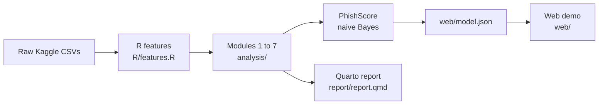

# PhishScope: Can Statistics Catch a Phish?

Classical probability and statistics (Modules 1 to 7) applied to telling phishing emails apart from legitimate mail, ending in a transparent score that runs in your browser.

## Headline result

PhishScore, a naive Bayes model on six statistically selected red flags, evaluated on a held-out test set (Wilson 95% intervals):

| Metric | Value |
|---|---|
| Sensitivity | 0.746 [0.723, 0.768] |
| Specificity | 0.969 [0.966, 0.972] |
| Precision at 1% phishing prevalence | 0.196 (0.492 when re-scored with a 1% prior) |
| AUC | 0.920 |

At a realistic base rate most alerts are false alarms, and sensitivity drops by 0.41 on an unseen corpus, so PhishScope is an early-warning aid, not a spam filter.

## Live demo

**[Open the PhishScope checker](https://YOUR-GITHUB-USERNAME.github.io/PhishScope/)** (published from `web/` by GitHub Pages; replace the link with your Pages URL).


*Screenshot placeholder: add `docs/screenshot.png`.*

Everything runs client-side: nothing you paste is sent anywhere.

## How it fits together



## Modules and methods

| Module | Script | Methods |
|---|---|---|
| 1 Descriptive statistics | `analysis/01_descriptive.R` | mean, median, mode, quartiles, IQR, variance, CV, skewness, kurtosis, boxplots, histograms |
| 2 Random variables | `analysis/02_random_variables.R` | PMF, CDF, expectation, joint PMF, Bayes at sample and 1% prior, covariance, MGF |
| 3 Correlation and regression | `analysis/03_correlation_regression.R` | Spearman (rank-difference formula), partial correlation, linear probability model, logistic comparison |
| 4 Distributions | `analysis/04_distributions.R` | binomial, Poisson, normal, exponential, gamma vs Weibull vs lognormal (AIC/BIC) |
| 5 Large-sample tests | `analysis/05_large_sample_tests.R` | Z tests for proportions and means, power, Type I and II errors |
| 6 Small samples and ANOVA | `analysis/06_small_sample_anova.R` | t, F, chi-square GOF and independence, Holm, Cramer's V, one/two/three-way ANOVA, Tukey, CRD/RBD/Latin square |
| 7 Reliability | `analysis/07_phishscore_reliability.R` | series/parallel systems, user-level reliability, MTTF, availability; PhishScore validation |

## Setup

Requires R 4.6, Quarto and Node 22+. Put the Kaggle CSVs in `data/raw/`, then:

```bash
Rscript -e "renv::restore()"
Rscript run.R all
Rscript -e "testthat::test_dir('tests/testthat')"
node --test "tests/js/*.test.mjs"
python -m http.server 8000 -d web
```

`run.R all` builds the data, runs Modules 1 to 7, exports `web/model.json` and renders `report/report.html` and `report/report.pdf`. Run a single stage with `Rscript run.R data | analysis | report`.

Commits are scanned by a gitleaks pre-commit hook (`pip install pre-commit && pre-commit install`). See [SECURITY.md](SECURITY.md).

## Data

Kaggle "Phishing Email Dataset": Al-Subaiey, A. et al. (2024). Novel interpretable and robust web-based AI platform for phishing email detection. arXiv:2405.11619. The CSVs are not committed; no dataset email text is stored in this repository.
